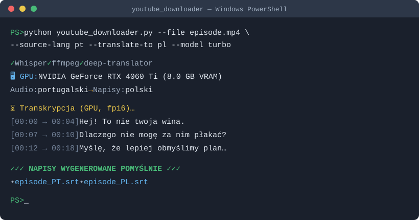

# 🎬 YouTube Downloader + AI Subtitles

> Download any YouTube video (or use a local file), generate subtitles with **OpenAI Whisper** or **Qwen3-ASR** (higher accuracy, incl. a hybrid cross-check mode), and **translate them into any language** — fully automated, GPU-accelerated, and resilient to errors.

<p align="center">
  <a href="https://github.com/msikorski-sketch/ytsubtran/actions/workflows/ci.yml"></a>
  
  
  
  
  
</p>

<p align="center">
  
</p>

---

## ✨ Why this tool?

Most "YouTube to subtitles" scripts break the moment YouTube changes something, mis-detect the spoken language, or produce garbled, looping text. This one is built to **just work**:

- 🛡️ **Self-healing downloads** — auto-installs/updates `yt-dlp`, tries multiple format strategies, resumes interrupted transfers, bypasses geo-blocks, and diagnoses failures in plain language.
- 🌐 **Smart language detection** — samples *several* points in the audio (not just the first 30 s), so an English intro on a dubbed video won't fool it.
- 🎯 **High-quality transcription** — anti-hallucination decoding (no more `"I'm sorry"` × 20 loops) and an optional context prompt for names & jargon.
- 🔁 **Built-in translation** — turn a Portuguese video into Polish subtitles in one command.
- ⚡ **GPU acceleration** — automatically uses your NVIDIA card (with CPU fallback if VRAM runs out).

## 🎥 See the difference

Real example — a Portuguese-dubbed video with an English intro:

**❌ Without language fix (wrong language detected from intro):**
```
We lost everything, that's it. This guy was able to make the biggest shit of all.
I'm sorry. I'm sorry. I'm sorry. I'm sorry. I'm sorry. I'm sorry...
```

**✅ With `--source-lang pt --model turbo` (correct):**
```
Hej! To nie twoja wina.
Dlaczego nie mogę za nim płakać?
Myślę, że lepiej obmyślimy plan powstrzymania Jaxa.
```

---

## 🚀 Quick start

```bash
# 1. Install (gets the `ytsubtran` command + all dependencies)
pip install .
# (also install ffmpeg and add it to PATH — see the full guide)

# 2. Download a video + Polish subtitles
ytsubtran "https://youtube.com/watch?v=VIDEO_ID" --subs
```

That's it. Subtitles (`.srt` + `.txt`) appear next to the downloaded file.

> Prefer not to install? You can always run the script directly:
> `python youtube_downloader.py "URL" --subs`

---

## 🧰 Features at a glance

| Capability | How |
|---|---|
| Download video (MP4) | `ytsubtran "URL"` |
| Download audio only (MP3) | `... --format mp3` |
| Generate subtitles | `... --subs` |
| Best-quality transcription (Qwen3-ASR) | `... --subs --engine qwen` |
| Cross-check Whisper with Qwen (any language) | `... --subs --engine hybrid` |
| Translate subtitles → Polish | `... --subs --source-lang es --translate-to pl` |
| Translate an existing SRT/VTT without a video | `--subtitle-file captions.srt --translate-to pl` |
| Reuse a completed transcription | automatic when media and ASR settings match |
| Run speech recognition again | `... --force-transcribe` |
| Context-aware LLM translation (Gemini) | `... --translate-to pl --translate-engine gemini` |
| Force the spoken language (default: auto-detect) | `... --source-lang en` |
| Work on a local file (no download) | `--file "C:\videos\clip.mp4"` |
| Guarantee smooth editing in DaVinci Resolve | `--resolve` (also with `--file`) |
| Same for free DaVinci Resolve on Linux (ProRes Proxy + PCM) | `--resolve-linux` |
| Pick a Whisper model | `--model turbo` (or `large-v3`, `medium`, …) |
| Improve accuracy with context | `--prompt "Pomni, Ragatha, Jax, Caine"` |
| Age-restricted / "not a bot" videos | `--cookies-from-browser chrome` |
| Choose where files are saved | `--output-dir "C:\downloads"` |
| Save a default output folder (persists) | `--set-output-dir "D:\edit"` |
| Re-download something already fetched | `--force-download` |
| Avoid YouTube throttling (503s) | `--limit-rate 5M` |
| Download whatever you copy (watch mode) | `--watch-clipboard` |
| Also export WebVTT subtitles | `--vtt` |
| Burn subtitles into the video | `--burn` |
| Embed a toggleable subtitle track | `--embed` |
| Detect inserted clips / interstitials | `--find-inserts` |
| Cut them out (SponsorBlock → heuristic → AI) | `--cut-inserts` |
| Smart detection with Gemini (multimodal) | `--smart-inserts` |
| Save each insert as its own named clip (to reuse) | `--extract-inserts` |
| Reuse a saved cut list (no second Gemini call) | `--from-list FILE` |
| Snap cuts to scene boundaries (frame-accurate) | `--snap-cuts` |
| Catalog a folder of unnamed lecture videos | `--organize "C:\downloads"` |
| Diagnose the active installation and GPU | `--doctor` (or `--doctor --json`) |
| Configure a Gemini key without putting it in shell history | `--set-gemini-key` |

## 📦 Installation

You need **Python 3.9+** and **ffmpeg** on your PATH.

```bash
python -m venv .venv
# Windows:  .\.venv\Scripts\activate
# Linux/mac: source .venv/bin/activate

# Install the package (provides the `ytsubtran` command):
pip install .

# …or, if you just want the dependencies without installing the command:
pip install -r requirements.txt
```

**Arch / CachyOS and other distros with an "externally managed" Python:** the
system `pip` refuses to install packages (and may be missing entirely), so the
script cannot auto-install `yt-dlp` there. Use the venv above, then link the
command onto your PATH:

```bash
python -m venv .venv && .venv/bin/pip install -e .
ln -sf "$PWD/.venv/bin/ytsubtran" ~/.local/bin/ytsubtran
```

**Deno** (`sudo pacman -S deno`, `brew install deno`, …) is recommended: yt-dlp
uses it to solve YouTube's JavaScript challenges; without it some formats may be
missing.

**ffmpeg:** download from [gyan.dev](https://www.gyan.dev/ffmpeg/builds/) (Windows) or `sudo apt install ffmpeg` / `brew install ffmpeg`.

> 📖 **Full step-by-step Windows guide (Polish):** [`YouTube_Downloader_Instrukcja_Windows.html`](YouTube_Downloader_Instrukcja_Windows.html)

## ⚡ GPU acceleration (NVIDIA)

By default PyTorch runs on CPU, which is slow for big models. With an NVIDIA card:

```bash
pip uninstall -y torch
pip install torch --index-url https://download.pytorch.org/whl/cu126
python -c "import torch; print(torch.cuda.is_available())"   # should print True
```

The script auto-detects the GPU, reports its name and VRAM, transcribes with `fp16`, and falls back to CPU if it runs out of memory. Match the `cu1XX` number to your driver (check `nvidia-smi`).

### Check the installation (`--doctor`)

```bash
ytsubtran --doctor
ytsubtran --doctor --json
```

The report identifies the Python executable, imported source path, commit and local
changes, ffmpeg/ffprobe, ASR and translation packages, CUDA access, NVIDIA driver,
cached Whisper model filenames and free disk space. This helps catch an installed
command pointing at a different checkout. It imports dependencies but does not
load model weights, download models, change settings or call external APIs.
Package presence and a configured key do not prove that a remote service is working.

For Gemini translation, configure the key in your own terminal:

```bash
ytsubtran --set-gemini-key
```

The key is entered with a hidden prompt, not as a command argument. It is saved
atomically in `~/.ytsubtran.json`, preserving other settings; on POSIX the replaced
file is owner-readable/writable only. `--doctor` shows presence and source, never
the value. `GEMINI_API_KEY`/`GOOGLE_API_KEY` environment variables still take
precedence over the saved key. Saving a key does not make a paid API request or
verify access.

Local validation on 2026-11-13 used Python 3.14.8, PyTorch 2.14.0+cu126,
Whisper 20250625 and an RTX 4060 Ti (8 GB). A synthetic 13.68-second clip produced
three English subtitle segments with the `base` model. The first CLI run took
8.27 s, reuse took 0.12 s and a forced rerun took 5.08 s in that single test.
This checks the GPU/cache workflow, not transcription accuracy: the small model
made two word substitutions in synthesized speech. Polish reference subtitles
were parsed by mpv and their diacritics checked on a rendered frame. Live Google
translation returned HTTP 429; Gemini needs a user-provided key to complete that
part of the end-to-end test.

## 🧠 Whisper models

| Model | RAM/VRAM | Speed | Quality | Best for |
|---|---|---|---|---|
| `tiny` | ~1 GB | fastest | low | quick tests |
| `base` | ~1 GB | fast | fair | simple speech |
| `small` | ~2 GB | medium | good | clearer transcripts |
| **`turbo`** ⭐ | ~6 GB | fast | very good | **best all-round, esp. on 8 GB GPUs** |
| `medium` | ~5 GB | slow | very good | real videos without a strong GPU |
| `large-v3` | ~10 GB | slowest | best | maximum accuracy |

Any name Whisper supports works — newer models will too, no code changes needed.

## 🎯 Transcription engines: Whisper vs Qwen3-ASR (`--engine`)

Since 2026 Whisper is no longer the most accurate open ASR model. The script also
supports **Qwen3-ASR** (Alibaba, Apache-2.0), which beats Whisper on benchmarks —
especially for Japanese, Chinese and Korean — and runs locally on your GPU:

```bash
pip install -U qwen-asr        # one-time; models download on first use (~5.5 GB)
```

| Engine | What it does | Best for |
|---|---|---|
| `--engine auto` *(default)* | Qwen3-ASR if installed + CUDA GPU present, else Whisper | everyday use |
| `--engine qwen` | Qwen3-ASR + ForcedAligner timestamps | ja, en, zh, ko, es, de, fr, it, pt, ru, yue |
| `--engine hybrid` | Whisper timestamps + Qwen text, plus an agreement report | **Polish** and other languages the aligner can't timestamp; verifying Whisper |
| `--engine whisper` | classic Whisper only | no GPU, minimal installs |

Notes:

- Qwen's aligner (timestamps) covers 11 languages — **Japanese yes, Polish no**.
  For Polish (and the rest of Qwen's 30 languages) `qwen` automatically switches
  to `hybrid`: Whisper provides the timing, Qwen re-transcribes each segment for
  better text, and you get a Whisper-vs-Qwen agreement report (a built-in
  cross-check; strongly differing segments are listed with both versions).
- `--qwen-model Qwen/Qwen3-ASR-0.6B` picks the lighter model if VRAM is tight.

## 🌐 Translation engines (`--translate-engine`)

Subtitles are translated segment-by-segment through **Google Translate** by default
(free, no key). For noticeably better quality add `--translate-engine gemini`: the
whole transcript is sent to the **Gemini API** in one context-aware request, so
terminology stays consistent and grammar flows across segment boundaries — the
biggest win for Japanese/Chinese/Korean sources. It reuses the same API key as
`--smart-inserts`/`--organize` (asks once, saves to `~/.ytsubtran.json`) and falls
back to Google Translate automatically on any error. Pick the model with
`--translate-model` (default: `gemini-3.5-flash-lite`). This replaces the deprecated
Gemini 2.5 Flash translation default; access to that older model is restricted to
prior users, according to [Google's deprecation schedule](https://aistudio.google.com/docs/deprecations).

If Google translation fails for any non-empty segment, the tool reports the
failed count and keeps the original subtitles. It does not write translated
files or burn/embed untranslated text under the target language label. Retry the
command when the translator is available; existing translated files are preserved.

```bash
# Japanese video -> best-quality Polish subtitles (Qwen3-ASR + Gemini):
ytsubtran "URL" --subs --engine qwen --source-lang ja --translate-to pl --translate-engine gemini
```

## Reuse a transcription and translate existing subtitles

Completed speech recognition is saved **before translation** as
`<media filename>.transcription.json` in the output folder (for example,
`video.mp4.transcription.json`). Repeat the command to retry a failed translation,
pick another target language, or add VTT output without running Whisper/Qwen again:

```bash
ytsubtran --file video.mp4 --source-lang en --translate-to pl --output-dir results
# If translation failed, run the same command again. To add another language:
ytsubtran --file video.mp4 --source-lang en --translate-to de --output-dir results
```

Reuse requires the same output folder, source path, file size, modification time,
ASR options (engine, model, source language, prompt), and installed Whisper/Qwen
versions. Translation settings do not invalidate the saved transcription. Use
`--force-transcribe` to run ASR again, including after a hardware change. Invalid
or incomplete state files are ignored. This resumes from a **completed transcription**;
an interrupted ASR run itself still starts over. Local Resolve conversion uses the
original file's identity so repeating that conversion does not invalidate ASR state.

To translate subtitles you already have — including files you corrected by hand —
use a standalone mode that needs **no media, ffmpeg or ASR model**:

```bash
ytsubtran --subtitle-file captions.srt --source-lang en --translate-to pl
ytsubtran --subtitle-file captions.vtt --translate-to pl --translate-engine gemini
# --file also recognizes SRT/VTT inputs:
ytsubtran --file captions.srt --translate-to de --output-dir translations --vtt
```

Input must be UTF-8 SRT or WebVTT. The output is `captions_PL.srt` or
`captions_PL.vtt`, plus a `.txt` copy, in the source folder unless `--output-dir`
is given. `--vtt` also exports a VTT when the input is SRT. Input files stay
unchanged; cue IDs, timing lines, VTT settings, notes and style/region blocks are
preserved in the matching output format. Formatting tags and inline timestamps
are protected during translation; if the translator changes those tokens, the
operation fails before writing outputs. Media editing and ASR options cannot be
combined with standalone subtitle translation.

## 📋 Clipboard watch mode (`--watch-clipboard`)

Leave it running and just copy links — each one downloads by itself, with whatever
options you started it with:

```bash
ytsubtran --watch-clipboard --resolve --subs --translate-to pl
```

- **Keep copying while a download runs** — the clipboard is watched in a separate
  thread, so new links land in a queue instead of being missed, and are downloaded
  one after another. Each message tells you how many are still waiting.
- Copying a **whole block of text** queues every link inside it, so you can select a
  list of posts (e.g. in Discord), hit Ctrl+C once, and get all of them.
- Understands `watch?v=`, `youtu.be`, `shorts`, `live` and `embed` links, and drops
  duplicates within the same copy.
- Whatever is in the clipboard **before** you start is left alone — copy it again and
  it downloads (on Windows even an identical re-copy is detected).
- Each video is handled once per session, and the duplicate detection below keeps
  re-runs from downloading anything twice.
- **The queue lives on disk** (`.ytsubtran_queue.json` in the output folder), so it
  survives a closed window, a crash or a reboot: whatever was left — including the
  link that was mid-download — is picked up automatically the next time you start
  watch mode. You can open (or edit) that file at any point to see what is waiting.
- A failed download does not stop the queue; on Ctrl+C anything still queued stays in
  the file and is listed on screen.
- `--watch-interval` changes how often the clipboard is checked (default: 1 s).
  Stop with Ctrl+C.

## 🔁 Duplicate detection (on by default)

Nothing is downloaded twice. Each output folder keeps a small index
(`.ytsubtran_downloads.json`) and every finished download is recorded there, so a
second run of the same link stops immediately and tells you exactly why:

```text
⏭️  ALREADY DOWNLOADED — skipping the download
Video id:   UV0mhY2Dxr0  (matched by YouTube id, not by file name)
File:       D:\edit\Nature Relaxation Film 4K [UV0mhY2Dxr0] [5-12s].mp4
Size:       13.3 MB
Downloaded: 2026-08-08 13:11:23
Match:      same video + same format (mp4) + same range (5.000-12.000 s)
```

What makes it trustworthy:

- **Matched by YouTube video id**, not by file name — renamed titles still match,
  and new downloads include the ID in their name (`Title [VIDEO_ID].mp4`), so
  different videos with the same title stay separate. Legacy index entries that
  assign one file to multiple video IDs trigger a fresh download.
- **Format and range are part of the match**: an MP3 is not a duplicate of an MP4,
  and a `--start/--end` fragment is never mistaken for the full video (fragments
  also get their range in the file name, e.g. `… [5-12s].mp4`).
- **Quality is part of the picture.** The stored resolution is shown on every skip,
  and anything below 720p is flagged — when YouTube throttling forces a fallback
  format (360p), you are told instead of having that copy silently accepted forever.
- **The file must really be there.** If it was deleted, moved or left incomplete
  (`.part`), the script says so and downloads it again instead of silently skipping.
- **Files the index doesn't know** are accepted only with the requested ID and
  range in their name. If yt-dlp skips an existing file, its real duration is also
  checked before any post-processing. Duration alone never establishes identity;
  legacy title-only files without an index entry are left untouched.
- Skipping the download still runs everything else you asked for — subtitles,
  `--resolve` normalization, insert detection — on the existing file.
- Playlist links use yt-dlp's own download archive (`.ytsubtran_archive.txt`), so
  already-fetched items are skipped item by item.
- `--force-download` ignores all of this and fetches a fresh copy (overwriting).

## 🎬 DaVinci Resolve preset (`--resolve`)

YouTube increasingly serves VP9/AV1 video with Opus audio. Resolve 20 can
technically open most of it, but long-GOP VP9/AV1 decodes in software in the free
version (choppy timeline), Opus/10-bit H.264 fail outright in older or free
versions, and variable frame rate drifts audio. `--resolve` guarantees files that
just edit:

1. **Downloads native H.264 (avc1) + AAC first** — no transcode, no quality loss
   (YouTube offers avc1 up to ~1080p; higher-res sources fall through to the
   normal strategies and get normalized below).
2. **Verifies the final file with ffprobe** and re-encodes only what's wrong,
   per the official Resolve 20 codec list:
   - VP9/AV1/HEVC video → H.264 8-bit 4:2:0 (CRF 18), Opus/Vorbis audio → AAC,
     VFR → constant frame rate, `+faststart` MP4;
   - **10-bit / 4:2:2 sources → DNxHR HQX in MOV + PCM audio** — free Resolve on
     Windows decodes H.264 only in 8-bit, and DNxHR keeps the full bit depth
     (bigger file, perfect scrubbing).
3. Works for local files too: `--file "clip.mp4" --resolve` writes a sibling
   `clip_resolve.*` and leaves the original untouched. On its own it only
   converts; add `--subs` (or `--translate-to`) to also generate subtitles, which
   are then named after the Resolve-ready file, so Resolve matches them.

### Free DaVinci Resolve on Linux (`--resolve-linux`)

The free Linux build of Resolve has no H.264/H.265 or AAC decoders, so even the
H.264+AAC files from `--resolve` import as offline media or without sound.
`--resolve-linux` converts the video to an **editing (intra-frame) codec** with
**PCM audio** in a sibling `*_resolve.mov`; DNxHR/ProRes/CineForm with PCM is left
as is. The codec is chosen with `--linux-codec` (default **`prores-proxy`**):

| `--linux-codec` | 1080p30 size | When |
|---|---|---|
| `prores-proxy` (default), `dnxhr-lb` | ≈ 0.35 GB/min | YouTube downloads (~2 Mb/s sources — more bitrate adds no detail) |
| `prores-lt` | ≈ 0.75 GB/min | own phone and camera H.264 (15–50 Mb/s) — visually transparent |
| `prores`, `dnxhr-sq` | ≈ 1–1.1 GB/min | higher-quality sources, colour grading |
| `prores-hq`, `dnxhr-hq` | ≈ 1.6 GB/min | camera originals, heavy grading |

ProRes is always 10-bit 4:2:2, so 10-bit sources keep their depth with any ProRes
profile; DNxHR LB/SQ/HQ are 8-bit, so 10-bit sources get DNxHR HQX instead.
The old `--dnxhr-profile X` still works and means `--linux-codec dnxhr-X`.

```bash
ytsubtran "URL" --resolve-linux
ytsubtran --file clip.mp4 --resolve-linux --linux-codec prores-lt   # own camera footage
```

## 💡 Getting the best quality

1. **Set the correct language** (`--source-lang`) — it is auto-detected by default, but the #1 cause of bad subtitles is wrong detection on dubbed content.
2. **Use Qwen3-ASR** (`--engine qwen`, or `hybrid` for Polish) — more accurate than Whisper.
3. **Use a bigger model** — `turbo` or `large-v3` (Whisper), `Qwen3-ASR-1.7B` (Qwen, default).
4. **Add `--prompt`** with character names / terminology (in the spoken language) — biases both engines.
5. **Use a GPU** to make big models practical.

## 📄 Output

Files are written next to the source, suffixed with the language code. When translating, **both** versions are saved:

```
video.mp4
video_PT.srt   video_PT.txt   # original transcription
video_PL.srt   video_PL.txt   # translated subtitles
```

Load the `.srt` in VLC (Subtitles → Add Subtitle File) or keep it next to the video.

## 🩹 Troubleshooting

| Problem | Fix |
|---|---|
| `HTTP 403` / `Unable to extract` | Script auto-updates `yt-dlp` and retries. Else: `pip install -U yt-dlp` |
| "Sign in to confirm your age / not a bot" | `python -m yt_dlp --cookies-from-browser chrome "URL"` |
| `HTTP 429 Too Many Requests` | Wait a few minutes / switch network or VPN |
| Garbled or looping subtitles | Set `--source-lang` explicitly; use `--model turbo`; add `--prompt` |
| CUDA out of memory | Use `--model turbo`/`medium`; close other GPU apps |
| Transcription very slow | Install CUDA PyTorch, or use a smaller model |

## ✂️ Inserts: extract them as clips, or cut them out

Short spliced-in clips ("bumpers", meme cuts, joke skits, intros/outros) can be
**extracted as separate named clips** (to reuse in your own edits) *or* **cut out**
of the video. Detection uses a layered cascade — each layer cross-checks the others:

1. **SponsorBlock** — if the YouTube video has community-labeled segments (the
   `filler` category = tangents/jokes), use those exact timestamps.
2. **Heuristic** — otherwise detect short spans with a sudden loudness jump (EBU
   R128) corroborated by a hard scene cut.
3. **AI cross-check** (optional, `--insert-ai`) — a local Ollama model confirms
   each candidate from its transcript.

```bash
ytsubtran "URL" --find-inserts                 # analyze only: prints/saves a cut list
ytsubtran "URL" --cut-inserts                  # also remove them (asks first; --yes to skip)
ytsubtran --file clip.mp4 --find-inserts --insert-jump 7 --insert-min-len 2
```

`--find-inserts` never edits the video — it only proposes a cut list for review.
`--cut-inserts` writes a new `*_nocuts.mp4`, leaving the original untouched.
Cutting supports videos with or without audio. The default heuristic requires a
nearby scene cut; an audio jump alone is accepted only with `--insert-any-audio`.
For downloads using `--start`/`--end`, SponsorBlock is skipped because its times
refer to the full video. Local detection uses the fragment's own timeline instead;
saved cut lists and Gemini analysis also use the file being processed.

### Mark inserts in DaVinci Resolve

[`resolve_markers.py`](resolve_markers.py) drops a coloured **timeline marker** at
every detected insert, so you can jump between them in Resolve instead of scrubbing.
Copy it into Resolve's script folder
(`…/Blackmagic Design/DaVinci Resolve/Support/Fusion/Scripts/Utility/`) and run it
from **Workspace → Scripts**. It auto-finds the `*_inserts.txt` next to the open
timeline's video; if the open clip doesn't match, it shows a **picker** of the lists
in that folder and warns about the mismatch. (If your Resolve build blocks scripting,
use the planned SRT-subtitle export instead.)

### Extract each insert as its own clip (`--extract-inserts`)

When you want to **reuse** the inserts (not delete them), add `--extract-inserts`.
Each detected segment is saved as a separate, descriptively-named file in a
`<video>_clips` folder — the original is never modified:

```bash
ytsubtran --file clip.mp4 --smart-inserts --extract-inserts
# →  clip_clips/01_00m05s_Animated intro sequence.mp4
#    clip_clips/02_02m11s_Reaction meme.mp4   …
```

File names are `NN_MMmSSs_<reason>.mp4` (index, timestamp, and the model's
description), so you can tell at a glance what each clip is.

### The cut list is editable — and reusable (`--from-list`)

Every detection run writes a plain-text cut list next to the video
(`<video>_inserts.txt`). It's human-readable and editable:

```
# Insert cut list — delete a line to drop that segment.
130.000	143.000	# Animated intro sequence
756.000	767.000	# Reaction meme
```

**Delete any line** to drop that segment, then feed the file back with
`--from-list` to extract or cut **without re-running detection** — so a paid
Gemini analysis only ever runs **once**:

```bash
# Re-uses the saved list — zero Gemini calls:
ytsubtran --file clip.mp4 --from-list "clip_inserts.txt" --extract-inserts
ytsubtran --file clip.mp4 --from-list "clip_inserts.txt" --cut-inserts
```

### Fine-tuning the boundaries

- `--snap-cuts` — snap each in/out point to the nearest detected scene cut for
  frame-accurate trims (refines the model's ±1 s timestamps).
- `--clips-copy` — with `--extract-inserts`, stream-copy clips (instant, no
  re-encode) instead of the default frame-accurate re-encode. Faster, but each
  clip starts at the nearest keyframe.

### Smart detection (Gemini)

For tightly-edited videos where inserts are *visual* (a cut to other footage, with
no loudness spike), the audio/scene heuristic has high recall but low precision. For
those, `--smart-inserts` sends the video to the **Gemini multimodal API**, which
actually watches it and returns the insert timestamps:

```bash
pip install google-genai          # one-time
ytsubtran --file clip.mp4 --smart-inserts                    # list inserts
ytsubtran --file clip.mp4 --smart-inserts --extract-inserts  # save them as clips
ytsubtran --file clip.mp4 --smart-inserts --cut-inserts      # remove them
```

On first use it asks for a Gemini API key ([get one free](https://aistudio.google.com/apikey))
and saves it to `~/.ytsubtran.json` (or read it from `GEMINI_API_KEY`). Note: this
uploads the video to Google's API.

Gemini classifies each hit as **`clip`** (footage from another video / meme / B-roll),
**`screenshot`** (a still image shown on screen), or **`caption`** (editor text/graphics).
By default only real `clip` interstitials are kept — pick others with
`--insert-kinds clip,screenshot,caption`. Run `--smart-inserts` **once**, then reuse the
saved `<video>_inserts.txt` with `--from-list` so Gemini is never billed twice.

## 🗂️ Catalog a folder of unnamed videos (`--organize`)

Course platforms like **DataCamp** let you download a lesson with a button, but it
lands on disk as `video (1).mp4`, `video (2).mp4`, … — no hint of which course it
belongs to. Catalog mode reads each file's slides (which usually print the course
and chapter title), asks Gemini what it is, then renames and sorts everything into
per-course folders:

```bash
ytsubtran --organize "C:\Users\me\Downloads"
```

Turns this:

```text
Downloads\
  video (1).mp4
  video (2).mp4
  video (3).mp4
```

into this:

```text
Downloads\
  Introduction to Docker\
    1 - What is Docker.mp4
    2 - Docker images.mp4
  Intermediate Python\
    Pandas basics.mp4
```

It **previews the full plan and asks before moving anything** (use `--yes` to skip
the prompt). Files it can't confidently identify are left untouched in an
`_Uncategorized\` folder for you to sort by hand. Any matching subtitle/transcript
side-cars (`.srt`/`.vtt`/`.txt`) follow their video and are renamed with it.
When video names share a prefix, each side-car follows the longest matching video
stem. Ambiguous side-cars (for example, two containers with the same stem) stay in
the source folder.

| Tweak | Flag |
|---|---|
| Skip the confirmation prompt | `--yes` |
| Also use the intro transcript (Whisper) | `--organize-transcript` |
| Sample more/fewer frames per video | `--organize-frames 8` |
| Pick the Gemini model | `--organize-model gemini-2.5-pro` |

By default it classifies from the **frames only** — for slide-based courses the
title is printed on screen, so that is both accurate and fast (no Whisper pass). Add
`--organize-transcript` to also transcribe each intro for videos with no on-screen
title. Press **Ctrl+C** at any time to stop scanning and still get a plan for what
was processed so far.

Like `--smart-inserts`, this uses the **Gemini multimodal API** and reuses the same
saved key (`~/.ytsubtran.json` or `GEMINI_API_KEY`). It uploads only a handful of
frames per video (not the whole file), so it stays cheap and fast.

## 📚 How it works

Want to understand the internals — or rebuild this from scratch? The
[**technical guide**](docs/HOW_IT_WORKS.md) explains every design decision: the
download fallback engine, robust language detection, anti-hallucination Whisper
parameters, GPU handling, the SRT format, translation, and a step-by-step build
order.

## 🤝 Contributing

Issues and pull requests are welcome! See [CONTRIBUTING.md](CONTRIBUTING.md).

## 📜 License

[MIT](LICENSE) — free to use, modify, and share.

## ⚖️ Disclaimer

For personal use. Respect YouTube's Terms of Service and the copyright of the content you download.

---

<p align="center"><sub>Built with ❤️ using <a href="https://github.com/openai/whisper">OpenAI Whisper</a> and <a href="https://github.com/yt-dlp/yt-dlp">yt-dlp</a>.</sub></p>
